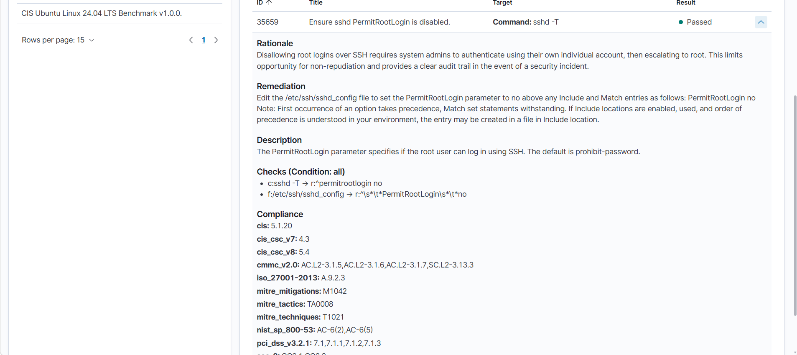
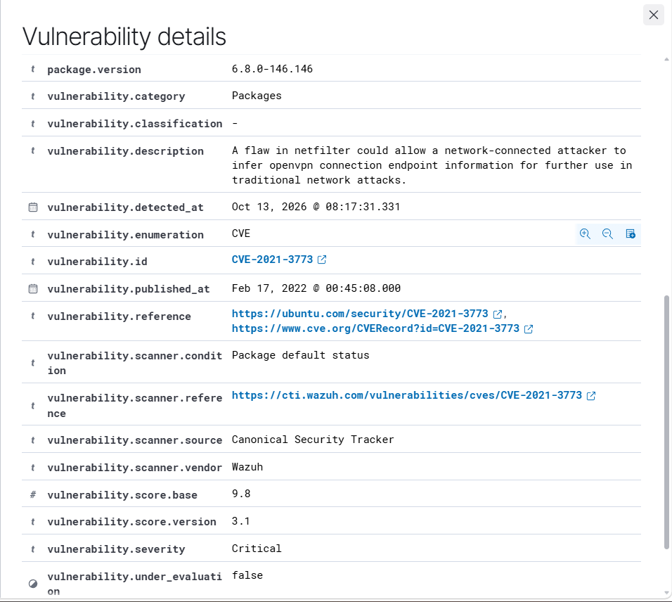

# Wazuh SIEM SOC Lab

**A hands-on Security Operations Center (SOC) laboratory built using Wazuh SIEM, WSL2, and VirtualBox.**

## Project Overview

This project demonstrates the deployment and operation of a Wazuh-based SIEM environment for centralized security monitoring, threat detection, event correlation, alert tuning, automated Active Response, File Integrity Monitoring (FIM), Security Configuration Assessment (SCA), vulnerability detection, and SOC investigation.

The laboratory simulates SSH authentication anomalies, repeated SSH activity triggering brute-force alerts, failed root SSH authentication detected by a tuned custom rule, and file integrity changes on an Ubuntu endpoint. It also incorporates controlled automated firewall containment, CIS Benchmark-based security assessments, Linux system hardening, and CVE vulnerability analysis.

Security events, configuration assessment results, and vulnerability findings are collected and investigated through the Wazuh Dashboard.

The project focuses on developing practical skills in SOC operations, Blue Team security, threat detection, vulnerability management, Linux security hardening, and incident response.

## Technologies Used

| Technology | Purpose |
|---|---|
| Wazuh 4.14.8 | SIEM, security monitoring, and vulnerability detection |
| Ubuntu Server 24.04 | Monitored endpoint |
| WSL2 Ubuntu | Wazuh central server |
| Oracle VirtualBox | Endpoint virtualization |
| Windows 11 | Host operating system |
| Linux SSH | Authentication monitoring and SSH hardening |
| Wazuh Syscheck | Real-time File Integrity Monitoring |
| Wazuh Custom Rules and Logtest | Detection engineering, rule testing, and validation |
| Wazuh Active Response and iptables | Automated threat containment and timeout-based firewall rule removal |
| Wazuh SCA | Security configuration assessment |
| Wazuh Vulnerability Detection | CVE identification and vulnerability analysis |
| CIS Benchmarks | Linux security configuration compliance |
| MITRE ATT&CK | Threat detection technique mapping |

## System Architecture

The laboratory consists of three main environments:

- **Windows 11 Host:** Runs VirtualBox and WSL2 and provides browser access to the Wazuh Dashboard.
- **WSL2 Ubuntu:** Hosts the Wazuh Manager, Indexer, and Dashboard.
- **VirtualBox Ubuntu Server:** Runs the Wazuh Agent and generates monitored security events.

The Wazuh Agent collects security events from the Ubuntu endpoint and forwards them to the Wazuh Manager for analysis and alert generation.

The agent also performs Security Configuration Assessment scans and collects software inventory information used for vulnerability detection.

[View Architecture Documentation](docs/architecture.md)

## Implemented Security Detection Scenarios

| Detection Scenario | Wazuh Rule | Severity | Status |
|---|---|---|---|
| SSH Invalid-User Detection | 5710 | Level 5 | Completed |
| SSH Brute-Force Alert Detection | 5712 | Level 10 | Completed |
| Custom Failed Root SSH Authentication Detection | 100002 | Level 10 | Completed |
| Controlled SSH Active Response Detection | 100003 | Level 5 | Completed |
| File Creation Detection | 554 | Level 5 | Completed |
| File Modification Detection | 550 | Level 7 | Completed |
| File Deletion Detection | 553 | Level 7 | Completed |
| Failed Sudo Authentication | 5404 | Level 10 | Completed |

### SSH Authentication & Brute-Force Detection

Conducted controlled SSH authentication simulations using a nonexistent username to evaluate Wazuh's authentication monitoring and brute-force event correlation capabilities.

**Detection Results:**

- **Rule 5710 (Level 5):** Detected SSH authentication attempts involving a nonexistent username.
- **Rule 5712 (Level 10):** Triggered a correlated SSH brute-force alert after repeated invalid-user connection events from the same source IP.
- Analyzed SSH logs, source IP addresses, authentication-related events, and Wazuh rule metadata to investigate suspicious activity.

**Technical Note:** The brute-force alert was generated from repeated invalid-user and pre-authentication connection events rather than confirmed password-guessing attempts.

**SOC Investigations:**

- [INC-001 — SSH Invalid User Detection](docs/investigations/INC-001-ssh-invalid-user.md)
- [INC-002 — SSH Brute-Force Detection](docs/investigations/INC-002-ssh-brute-force.md)

### Custom SSH Root Authentication Detection

Developed and deployed **custom Wazuh Rule 100002 (Level 10)** to detect failed SSH password and public-key authentication attempts targeting the `root` account. The rule was added to `/var/ossec/etc/rules/local_rules.xml`, tuned to reduce a demonstrated false-positive scenario, and validated using `wazuh-analysisd -t` and `wazuh-logtest` before live deployment.

**Custom Rule:**

```xml
<rule id="100002" level="10">
  <if_sid>5716</if_sid>
  <user type="pcre2">^root$</user>
  <description>Custom SOC Alert: Failed SSH authentication attempt for root account.</description>
  <group>authentication_failed,ssh_root_attempt,</group>
</rule>
```

**Live Detection Results:**

- Generated a controlled failed root SSH password authentication attempt from the Windows host to the Ubuntu VM.
- Verified that `ubuntu-soc-agent` forwarded the SSH event from `journald` to Wazuh Manager.
- Confirmed that Rule **100002** generated a **Level 10** alert in both `alerts.json` and the Wazuh Dashboard.
- Investigated the source IP `192.168.56.1`, source port `63863`, and destination user `root`.
- Confirmed that root SSH login remained denied; **no successful root login or compromise was observed**.

**SOC Investigation:**

[INC-006 — Custom SSH Root Authentication Detection](docs/investigations/INC-006-custom-ssh-root-detection.md)

### SSH Root Alert Tuning and False-Positive Analysis

Improved **Rule 100002** by replacing the original substring match (`<match>for root from</match>`) with an exact username match (`<user type="pcre2">^root$</user>`). The original rule generated a Level 10 alert for a synthetic SSH message containing `root frombackup`, even though Wazuh did not decode a destination username.

**Validation Results:**

| Test Scenario | Observed Result |
|---|---|
| Failed root password authentication (Logtest) | Rule 100002 — Level 10 |
| Failed root public-key authentication (Logtest) | Rule 100002 — Level 10 |
| Synthetic false-positive (`root frombackup`) | Rule 5760 — Level 5; Rule 100002 did not trigger |
| Live failed root password authentication after deployment | Rule 100002 — Level 10 |

The tuned rule passed configuration validation and was deployed after testing. A new live alert was confirmed on **2026-10-15 at 18:17:45 (+05:30)** from `ubuntu-soc-agent`, with source IP `192.168.56.1` and destination user `root`.

**Alert-Tuning Documentation:**

[SSH Root Alert Tuning and False-Positive Analysis](docs/alert-tuning/SSH-Root-Alert-Tuning.md)


**Dashboard Evidence:**


### Automated Threat Containment — Wazuh Active Response

Implemented and validated **Wazuh Active Response** using a dedicated custom detection rule and temporary firewall blocking on the monitored Ubuntu endpoint.

**Implementation:**

- Developed **Rule 100003 (Level 5)** to match simulated failed SSH authentication for user `labtest` from the documentation-only source IP `192.0.2.10`.
- Verified the rule with `wazuh-logtest`, including a negative test using a different source IP.
- Generated a synthetic SSH log with `logger`; the Ubuntu agent collected it through `journald` and forwarded it to the Wazuh Manager.
- Configured `firewall-drop` to execute on **Agent 001** only when Rule 100003 triggers, with a **60-second timeout**.
- Confirmed that `iptables` inserted a `DROP` rule for `192.0.2.10` and automatically removed it after approximately 60 seconds.
- Verified the response lifecycle in `/var/ossec/logs/active-responses.log`, including `add` and `delete` commands.

**Observed result:** Automated containment and timeout-based removal succeeded in the controlled lab. The SSH event was **simulated**, not an actual intrusion, and the configuration is a test-specific proof of concept rather than a production blocking policy.

**Technical documentation:** [Wazuh Active Response Implementation](docs/active-response/Wazuh-Active-Response.md)

**Evidence:** [Active Response Test Results](evidence/active-response/README.md) · [Sanitized Execution Evidence](evidence/active-response/active-response-evidence.txt)

### File Integrity Monitoring (FIM)

Configured real-time File Integrity Monitoring using Wazuh Syscheck to monitor changes within `/opt/soc-fim-lab` on the Ubuntu endpoint.

**Detection Results:**

- **Rule 554 (Level 5):** Successfully detected file creation.
- **Rule 550 (Level 7):** Successfully detected file modification through integrity checksum changes.
- **Rule 553 (Level 7):** Successfully detected file deletion.

Investigated FIM alerts and analyzed file paths, event types, detection rules, and MITRE ATT&CK mappings.

**SOC Investigation:**

[INC-003 — File Integrity Monitoring](docs/investigations/INC-003-file-integrity-monitoring.md)

## Security Configuration Assessment (SCA)

Implemented Wazuh Security Configuration Assessment to evaluate the Ubuntu Server endpoint against the **CIS Ubuntu Linux 24.04 LTS Benchmark v1.0.0**.

The assessment identified security configuration weaknesses and provided recommendations for improving endpoint security.

### Initial SCA Assessment

| Metric | Result |
|---|---|
| Total Checks | 279 |
| Passed Checks | 112 |
| Failed Checks | 125 |
| Not Applicable | 42 |
| Compliance Score | 47% |

### SSH Root Login Security Hardening

Investigated **SCA Check 35659 — Ensure sshd PermitRootLogin is disabled**.

The initial assessment identified that direct SSH root login was not fully disabled.

**Investigation and Remediation:**

1. Investigated the failed CIS security configuration check.
2. Inspected the effective SSH configuration using `sshd -T`.
3. Identified that the existing configuration permitted key-based root authentication.
4. Configured `PermitRootLogin no` in the SSH configuration.
5. Validated the configuration using `sshd -t` and `sshd -T`.
6. Verified that normal administrative SSH access remained functional.
7. Triggered a new Wazuh SCA scan to validate remediation.

**Verification Result:**

| Security Check | Before | After |
|---|---|---|
| SCA 35659 — SSH Root Login Disabled | Failed | Passed |

### Latest SCA Assessment

| Metric | Result |
|---|---|
| Total Checks | 279 |
| Passed Checks | 120 |
| Failed Checks | 117 |
| Not Applicable | 42 |
| Compliance Score | 50% |

**Outcome:** The overall compliance score increased from **47% to 50%** across assessments, and SSH root login hardening was successfully verified.

Other SCA checks also changed status during this period; therefore, the full score improvement is not attributed solely to the SSH remediation.

**Security Investigation:**

[INC-004 — SSH Root Login Security Hardening](docs/investigations/INC-004-ssh-root-login-hardening.md)

**Remediation Evidence:**



## Vulnerability Detection and Analysis

Implemented Wazuh Vulnerability Detection to identify and investigate reported software vulnerabilities affecting the monitored Ubuntu Server endpoint.

The vulnerability inventory provides information about detected CVEs, severity ratings, affected software packages, and vulnerability references.

### Initial Vulnerability Detection Results

Wazuh reported the following findings for `ubuntu-soc-agent` (Agent ID: 001):

| Severity | Reported Findings |
|---|---:|
| Critical | 242 |
| High | 1,370 |
| Medium | 546 |
| Low | 49 |
| Pending Evaluation | 1,604 |
| **Total Records** | **3,811** |

These values represent vulnerability records reported by Wazuh at the time of assessment. They do not independently establish exploitability or indicate that every finding requires the same remediation.

### CVE-2021-3773 — Critical Vulnerability Investigation

Investigated a Critical vulnerability reported by Wazuh against the Ubuntu Server Linux kernel.

**Vulnerability Details:**

| Field | Result |
|---|---|
| CVE ID | CVE-2021-3773 |
| Reported Severity | Critical |
| CVSS v3.1 Score | 9.8 |
| Affected Component | Linux Kernel — Netfilter |
| Running Kernel | 6.8.0-146-generic |
| Installed Kernel Package Version | 6.8.0-146.146 |
| Ubuntu Advisory Status | Ignored — no upstream fix |
| Investigation Status | Initial Triage Completed — Monitoring Required |

**Investigation Activities:**

1. Identified CVE-2021-3773 through Wazuh Vulnerability Detection.
2. Verified the running Linux kernel using `uname -r`.
3. Confirmed the installed kernel package version using `dpkg-query`.
4. Reviewed the official Ubuntu security advisory for vulnerability status and remediation information.
5. Investigated potential exposure by checking OpenVPN package installation, running processes, and executable availability.
6. Documented the findings and recommended continued vulnerability monitoring.

**Exposure Assessment Results:**

| Verification | Result |
|---|---|
| OpenVPN package installed | No |
| OpenVPN process detected | No |
| OpenVPN executable found | No |
| Vulnerability reported by Wazuh | Yes |
| Exploitability confirmed | No |
| Remediation verified | No |

**SOC Assessment:**

The reported OpenVPN-related information-disclosure scenario appears less applicable to the current laboratory because OpenVPN was not detected on the monitored endpoint.

However, the absence of OpenVPN does not prove that the underlying Linux kernel vulnerability is fixed or that all potential exposure has been eliminated.

The finding remains under monitoring rather than being classified as remediated or a confirmed false positive.

**Security Investigation:**

[INC-005 — CVE-2021-3773 Vulnerability Investigation](docs/investigations/INC-005-cve-2021-3773-vulnerability-analysis.md)

**Vulnerability Evidence:**



**Official Reference:**

[Ubuntu Security — CVE-2021-3773](https://ubuntu.com/security/CVE-2021-3773)

## SOC Investigation Reports

| Investigation ID | Investigation | Status |
|---|---|---|
| INC-001 | SSH Invalid User Detection | Closed — Authorized Test |
| INC-002 | SSH Brute-Force Alert Investigation | Closed — Authorized Test |
| INC-003 | File Integrity Monitoring | Closed — Authorized Test |
| INC-004 | SSH Root Login Security Hardening | Closed — Remediation Verified |
| INC-005 | CVE-2021-3773 Vulnerability Investigation | Initial Triage Completed — Monitoring Required |
| INC-006 | Custom SSH Root Authentication Detection | Closed — Authorized Test |
| INC-007 | Linux Sudo Authentication Failure | Closed — Authorized Test |

Each investigation report includes relevant information such as:

- Security investigation objectives and methodology.
- Relevant Wazuh detection rules, SCA checks, or vulnerability findings.
- Security event, configuration, or vulnerability analysis.
- Investigation findings and validation results.
- Supporting screenshots and technical evidence.
- Investigation outcomes and security recommendations.

## SOC Monitoring Dashboard Review

Completed a security monitoring review using the Wazuh Threat Hunting Dashboard, focusing on alert trends, high-severity detections, and MITRE ATT&CK mappings.

**Monitoring Results:**
- Monitored endpoint: `ubuntu-soc-agent`
- Monitoring period: Last 30 days (September 17–October 17, 2026)
- Total security alerts: **800**
- High-severity alerts (Level 10+): **3**
- SSH brute-force alerts (Rule 5712): **1**
- Custom failed root SSH alerts (Rule 100002): **2**

**Key Activities:**
- Filtered security alerts by monitored endpoint.
- Investigated high-severity SSH authentication alerts.
- Reviewed historical alert trends and severity distribution.
- Analyzed MITRE ATT&CK mappings.
- Captured and documented SOC monitoring evidence.


**Evidence:** [SOC Monitoring Dashboard Screenshot](screenshots/soc-monitoring/soc-monitoring-dashboard.png)


## Custom Detection Rules

Developed and tested custom Wazuh detection rules to identify
suspicious SSH authentication activity and support controlled
automated response testing.

**Rule Files:**
- [Custom Detection Rules Documentation](rules/README.md)
- [Wazuh Custom Rules XML](rules/local_rules.xml)

**Key Implementations:**
- **Rule 100002 (Level 10):** Detects failed SSH authentication targeting the root account.
- **Rule 100003 (Level 5):** Detects controlled SSH events used for Active Response testing.
- **Alert Tuning:** Applied PCRE2 exact username matching to reduce false positives.
- **Validation:** Tested detection behavior using Wazuh Logtest and live security alerts.

**Safety Note:** Automated IP blocking was successfully tested
with a 60-second timeout and subsequently disabled.


## Documentation

- [System Architecture](docs/architecture.md)
- [Installation and Deployment Guide](docs/installation.md)
- [INC-001: SSH Invalid User Detection](docs/investigations/INC-001-ssh-invalid-user.md)
- [INC-002: SSH Brute-Force Detection](docs/investigations/INC-002-ssh-brute-force.md)
- [INC-003: File Integrity Monitoring](docs/investigations/INC-003-file-integrity-monitoring.md)
- [INC-004: SSH Root Login Security Hardening](docs/investigations/INC-004-ssh-root-login-hardening.md)
- [INC-005: CVE-2021-3773 Vulnerability Investigation](docs/investigations/INC-005-cve-2021-3773-vulnerability-analysis.md)
- [INC-006: Custom SSH Root Authentication Detection](docs/investigations/INC-006-custom-ssh-root-detection.md)
- [SSH Root Alert Tuning and False-Positive Analysis](docs/alert-tuning/SSH-Root-Alert-Tuning.md)
- [Wazuh Active Response Implementation](docs/active-response/Wazuh-Active-Response.md)
- [Active Response Evidence](evidence/active-response/README.md)
- [SOC Monitoring Dashboard Review](docs/soc-monitoring/SOC-Monitoring-Dashboard.md)
- [INC-007: Linux Sudo Authentication Failure](docs/investigations/INC-007-linux-sudo-authentication-monitoring.md)

## Skills Demonstrated

- SIEM deployment and configuration
- Wazuh Agent installation and management
- Centralized security log collection and analysis
- SSH authentication and brute-force alert detection
- Security event correlation
- Custom Wazuh detection rule development and validation
- Automated threat containment with Wazuh Active Response and `firewall-drop`
- Linux `iptables` verification and timeout-based rule removal
- Controlled synthetic security event generation and response validation
- SIEM alert tuning and false-positive analysis
- PCRE2-based exact username matching for SSH alerts
- Wazuh Logtest testing and live alert verification
- Real-time File Integrity Monitoring
- Security Configuration Assessment (SCA)
- CIS Benchmark-based security assessment
- Linux SSH configuration hardening
- Security misconfiguration identification and remediation
- Security compliance verification
- Vulnerability detection and CVE analysis
- Vulnerability triage and risk assessment
- Linux kernel and software package verification
- Vendor security advisory analysis
- Threat detection and security alert investigation
- MITRE ATT&CK mapping
- SOC incident analysis and documentation
- Linux system administration and troubleshooting
- Linux privileged-access monitoring and sudo authentication failure investigation

## Planned Enhancements

The following capabilities are planned for future development:

- [x] SIEM deployment and agent integration
- [x] SSH authentication and brute-force alert detection
- [x] Real-time File Integrity Monitoring
- [x] Security Configuration Assessment (SCA) implementation
- [x] SSH root login security hardening
- [x] Initial vulnerability detection and CVE investigation
- [ ] Additional CIS Benchmark remediation
- [ ] Additional CVE investigations and remediation validation
- [x] First custom Wazuh detection rule (Rule 100002)
- [x] Additional custom detection rule (Rule 100003 — Active Response lab)
- [ ] Further custom detection rules and coverage
- [ ] Additional security attack simulations
- [x] Alert tuning and false-positive analysis (Rule 100002)
- [x] Active Response testing (Rule 100003; 60-second temporary IP block)
- [x] Final SOC monitoring dashboard review


## Project Status

**Completed — Portfolio Ready**

Successfully implemented and validated centralized SIEM monitoring,
SSH threat detection, custom detection rules, alert tuning,
File Integrity Monitoring, CIS Benchmark assessments, Linux SSH
hardening, vulnerability investigations, and controlled Active Response.

Completed a final SOC monitoring dashboard review and documented
**seven SOC investigations** with supporting technical evidence.

The controlled Active Response blocking action was disabled
after successful testing.

Additional security scenarios and remediation activities remain
optional future enhancements.


**Disclaimer:** This project is an educational cybersecurity laboratory. All security simulations and configuration changes are performed within an authorized testing environment.
