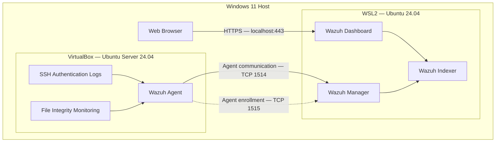

# Wazuh SIEM SOC Lab — System Architecture

## 1. Architecture Overview

This project implements a virtualized Security Information and Event Management (SIEM) laboratory using Wazuh 4.14.8.

The environment is designed to simulate SOC monitoring activities, including SSH authentication monitoring, brute-force detection, File Integrity Monitoring (FIM), and security incident investigation.

The lab runs on a Windows 11 host using Windows Subsystem for Linux 2 (WSL2) and Oracle VirtualBox.

## 2. Architecture Diagram



## 3. Host Machine

| Component | Specification |
|---|---|
| Operating System | Windows 11 |
| Processor | AMD Ryzen 5 7520U |
| RAM | 16 GB |
| Virtualization | Oracle VirtualBox and WSL2 |
| SIEM Platform | Wazuh 4.14.8 |

The Windows host provides the virtualization environment and is used to access the Wazuh Dashboard through a web browser.

## 4. Wazuh Central Components

The Wazuh central components are installed together inside WSL2 Ubuntu.

### Wazuh Manager

- Receives security events from monitored endpoints.
- Analyzes collected logs using detection rules.
- Correlates suspicious events.
- Generates security alerts.

### Wazuh Indexer

- Stores and indexes security alert data.
- Supports searching and analyzing collected events.

### Wazuh Dashboard

- Provides a web interface for SOC investigations.
- Displays alerts, monitored endpoints, and security events.
- Supports Threat Hunting and File Integrity Monitoring investigations.

**Dashboard URL:** `https://localhost`

The laboratory uses a self-signed HTTPS certificate.

## 5. Monitored Endpoint

An Ubuntu Server virtual machine runs inside Oracle VirtualBox.

| Component | Configuration |
|---|---|
| Operating System | Ubuntu Server 24.04 |
| Hostname | soc-siem |
| Wazuh Agent | 4.14.8 |
| Agent Name | ubuntu-soc-agent |
| Agent ID | 001 |
| Host-only IP | 192.168.56.10 |
| NAT IP | 10.0.2.15 |

The Wazuh Agent collects security-related information from the Ubuntu endpoint and sends it to the Wazuh Manager.

## 6. Network Architecture

The Ubuntu virtual machine uses two VirtualBox network adapters.

### NAT Adapter

- Provides network connectivity for the Ubuntu virtual machine.
- Assigned IP during testing: `10.0.2.15`.

### Host-Only Adapter

- Enables direct communication between the Windows host and Ubuntu VM.
- Windows host-only IP: `192.168.56.1`.
- Ubuntu VM host-only IP: `192.168.56.10`.

The host-only network was used to generate controlled SSH authentication events from Windows PowerShell.

### Wazuh Agent Communication

The Wazuh Agent communicates with the Wazuh Manager running inside WSL2.

| Port | Protocol | Purpose |
|---|---|---|
| 1514 | TCP | Wazuh Agent event communication |
| 1515 | TCP | Wazuh Agent enrollment |
| 443 | HTTPS | Wazuh Dashboard access |

**Note:** The WSL2 IP address is dynamically assigned and may change after restarting WSL2 or Windows. The Wazuh Agent configuration may need to be updated if the manager's address changes.

## 7. Security Monitoring Workflow

The security monitoring process follows these stages:

1. A security-relevant event occurs on the Ubuntu endpoint.
2. The Wazuh Agent collects the event.
3. The Agent forwards the event to the Wazuh Manager.
4. The Manager analyzes the event using detection rules.
5. Relevant security alerts are indexed.
6. The SOC analyst investigates the alerts through the Wazuh Dashboard.
7. Investigation findings are documented in GitHub.

## 8. Implemented Detection Scenarios

| Scenario | Wazuh Rule | Description |
|---|---|---|
| SSH invalid-user detection | 5710 | Detects SSH authentication attempts using nonexistent usernames |
| Repeated SSH activity | 5712 | Correlates repeated invalid-user SSH events |
| File creation | 554 | Detects new files in monitored directories |
| File modification | 550 | Detects file integrity checksum changes |
| File deletion | 553 | Detects removal of monitored files |

### File Integrity Monitoring Configuration

Real-time monitoring was configured on the Ubuntu endpoint using:

```xml
<directories check_all="yes" realtime="yes">/opt/soc-fim-lab</directories>
```

This configuration was added to the existing `<syscheck>` section of the Wazuh Agent configuration file.

## 9. SOC Investigation Reports

The project includes the following documented investigations:

- [INC-001 — SSH Invalid User Detection](https://github.com/Piranavi-Sasikaran/wazuh-siem-soc-lab/blob/main/docs/investigations/INC-001-ssh-invalid-user.md)

- [INC-002 — SSH Brute-Force Detection](https://github.com/Piranavi-Sasikaran/wazuh-siem-soc-lab/blob/main/docs/investigations/INC-002-ssh-brute-force.md)

- [INC-003 — File Integrity Monitoring](https://github.com/Piranavi-Sasikaran/wazuh-siem-soc-lab/blob/main/docs/investigations/INC-003-file-integrity-monitoring.md)

Each investigation documents the simulation, detection results, and SOC analyst findings.

## 10. Architecture Considerations

### Strengths

- Separates the monitored endpoint from the Wazuh central components.
- Provides practical experience with endpoint monitoring and log analysis.
- Supports controlled security simulations.
- Enables security event correlation and investigation.
- Uses an isolated test directory for FIM exercises.

### Limitations

- The lab runs on a single physical computer.
- The central Wazuh components share one WSL2 environment.
- The environment does not provide production-grade high availability.
- The WSL2 Manager IP address may change after a restart.
- The lab currently monitors one Ubuntu endpoint.

## 11. Conclusion

This architecture demonstrates the deployment of a functional Wazuh SIEM environment using WSL2 and VirtualBox.

The project provides hands-on experience in SIEM infrastructure, endpoint monitoring, SSH security detection, File Integrity Monitoring, event correlation, and SOC incident investigation.

Future development will expand the laboratory with Security Configuration Assessment (SCA), vulnerability detection, custom rules, and additional security monitoring scenarios.
