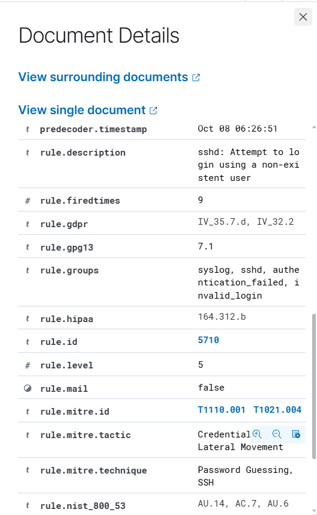

# INC-001: SSH Invalid User Detection

## 1. Incident Overview

**Incident ID:** INC-001  
**Category:** SSH Authentication Failure  
**SIEM Platform:** Wazuh 4.14.8  
**Monitored Endpoint:** Ubuntu Server 24.04  
**Agent Name:** ubuntu-soc-agent  
**Status:** Closed — Authorized Security Testing

## 2. Objective

Evaluate Wazuh's ability to detect SSH authentication attempts using nonexistent usernames and investigate the resulting security alerts.

## 3. Lab Environment

- **SIEM Server:** Wazuh running on WSL2 Ubuntu
- **Monitored Endpoint:** Ubuntu Server running in VirtualBox
- **Wazuh Agent:** 4.14.8
- **Source IP:** `192.168.56.1`
- **Target Username:** `fakeuser`
- **Log Source:** `journald`

## 4. Attack Simulation

An authorized SSH login attempt was performed from Windows PowerShell using a nonexistent username.

**Command:**

```powershell
ssh fakeuser@192.168.56.10
```

An incorrect password was entered to generate an authentication failure.

## 5. Detection Results

| Field | Observed Value |
|---|---|
| Rule ID | 5710 |
| Description | sshd: Attempt to login using a non-existent user |
| Severity | Level 5 |
| Source IP | 192.168.56.1 |
| Target Username | fakeuser |
| Decoder | sshd |
| Agent | ubuntu-soc-agent |

**Observed SSH log:**

```text
Failed password for invalid user fakeuser from 192.168.56.1
```
## Evidence


## 6. MITRE ATT&CK Mapping

- **T1110.001:** Password Guessing
- **T1021.004:** SSH

These mappings describe the behavior associated with the alert. The activity was an authorized laboratory simulation.

## 7. SOC Investigation

The Wazuh agent collected SSH authentication logs from the Ubuntu endpoint and forwarded them to the Wazuh Manager.

The SIEM generated rule 5710 after detecting an authentication attempt involving a nonexistent username.

The investigation confirmed the source IP address, target username, event description, and authentication failure.

## 8. Incident Classification

**Classification:** True Positive — Authorized Simulation  
**Impact:** No successful unauthorized access observed  
**Containment:** Not required  
**Resolution:** Testing completed successfully

## 9. Conclusion

This exercise demonstrated Wazuh's ability to detect suspicious SSH authentication attempts and provided practical experience investigating authentication-related security alerts.
