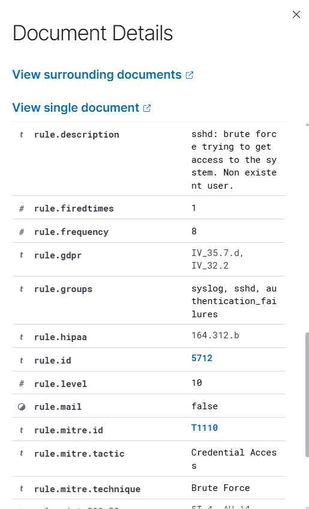

# INC-002: SSH Brute-Force Detection

## 1. Incident Overview

**Incident ID:** INC-002  
**Category:** SSH Brute-Force Detection  
**SIEM Platform:** Wazuh 4.14.8  
**Monitored Endpoint:** Ubuntu Server 24.04  
**Agent Name:** ubuntu-soc-agent  
**Status:** Closed — Authorized Security Testing

## 2. Objective

Evaluate Wazuh's ability to correlate repeated suspicious SSH authentication-related events and generate a higher-severity security alert.

## 3. Lab Environment

- **SIEM Server:** Wazuh Manager, Indexer, and Dashboard running in WSL2 Ubuntu
- **Monitored Endpoint:** Ubuntu Server running in VirtualBox
- **Wazuh Agent:** 4.14.8
- **Source IP:** `192.168.56.1`
- **Destination IP:** `192.168.56.10`
- **Target Username:** `fakeuser`
- **Log Source:** `journald`

## 4. Attack Simulation

A controlled SSH connection simulation was performed from Windows PowerShell against the Ubuntu lab endpoint.

The test generated ten SSH connection attempts using a nonexistent username.

**PowerShell command:**

```powershell
1..10 | ForEach-Object {
    ssh -o BatchMode=yes -o PreferredAuthentications=password -o PubkeyAuthentication=no -o ConnectTimeout=5 fakeuser@192.168.56.10
    Start-Sleep -Seconds 2
}
```

The `BatchMode=yes` option disabled interactive password prompts. Therefore, this test generated repeated invalid-user and pre-authentication connection-reset events rather than confirmed failed password submissions.

All activity was performed against an authorized lab system.

## 5. Detection Results

| Field | Observed Value |
|---|---|
| Rule ID | 5712 |
| Description | sshd: brute force trying to get access to the system. Non existent user. |
| Severity | Level 10 |
| Source IP | 192.168.56.1 |
| Target Username | fakeuser |
| Agent | ubuntu-soc-agent |
| Decoder | sshd |
| Correlation Frequency | 8 |
| Rule Fired Times | 1 |

**Observed SSH log:**

```text
Oct 08 06:26:51 soc-siem sshd[4699]: Connection reset by invalid user fakeuser 192.168.56.1 port 52842 [preauth]
```

The Wazuh alert also included `previous_output` containing earlier invalid-user and connection-reset events from the same source IP.
## Evidence



## 6. Detection Analysis

Wazuh correlated repeated SSH authentication-related events using rule 5712.

The rule was configured with:

- **Frequency:** 8 matching events
- **Timeframe:** 120 seconds
- **Ignore period:** 60 seconds
- **Source correlation:** Same source IP address

The correlation produced a Level 10 security alert.

This demonstrates the difference between detecting individual suspicious events and identifying repeated activity through correlation.

## 7. MITRE ATT&CK Mapping

**Tactic:** Credential Access  
**Technique:** T1110 — Brute Force

Reference: https://attack.mitre.org/techniques/T1110/

The MITRE mapping reflects the behavior identified by the Wazuh detection rule. The observed logs do not establish that actual password guessing occurred or that an account was compromised.

## 8. SOC Investigation

The investigation identified multiple SSH connections using the nonexistent username `fakeuser` from `192.168.56.1`.

The events were collected by the Wazuh Agent and analyzed by the Wazuh Manager.

Rule 5712 generated one correlated alert at severity level 10.

The source IP was identified as the Windows host used to conduct the authorized simulation.

No successful authentication or unauthorized access was observed.

## 9. Incident Classification

**Classification:** True Positive — Authorized Simulation  
**Impact:** No successful unauthorized access observed  
**Containment:** Not required  
**Resolution:** Testing completed successfully

## 10. Key Learning Outcomes

- Generated controlled SSH authentication-related events.
- Investigated individual and correlated SSH detections.
- Analyzed Wazuh rule 5712.
- Interpreted source IP, username, severity, and event metadata.
- Understood frequency-based event correlation.
- Mapped the detection to MITRE ATT&CK T1110.
- Documented SOC investigation findings.

## 11. Conclusion

This exercise demonstrated Wazuh's ability to correlate repeated invalid-user SSH events and generate a higher-severity alert.

The investigation provided practical experience in security event correlation, alert analysis, and SOC incident documentation.
