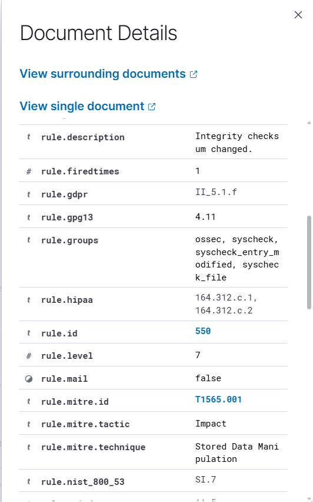
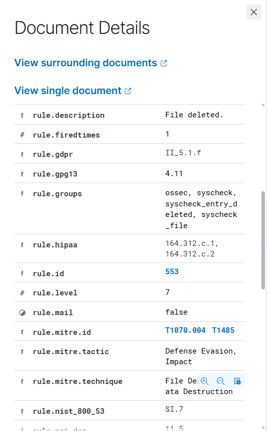

# INC-003: File Integrity Monitoring Investigation

## 1. Incident Overview

**Incident ID:** INC-003  
**Category:** File Integrity Monitoring (FIM)  
**Platform:** Wazuh SIEM 4.14.8  
**Monitored Endpoint:** Ubuntu Server 24.04  
**Agent Name:** ubuntu-soc-agent  
**Status:** Closed — Authorized Security Testing

### Objective

Evaluate Wazuh's ability to detect file creation, modification, and deletion events on a monitored Ubuntu endpoint.

## 2. Lab Environment

- **SIEM Platform:** Wazuh Manager, Indexer, and Dashboard running in WSL2 Ubuntu
- **Monitored Endpoint:** Ubuntu Server running in VirtualBox
- **Wazuh Agent:** 4.14.8
- **Monitored Directory:** `/opt/soc-fim-lab`
- **Monitoring Method:** Real-time File Integrity Monitoring using Wazuh Syscheck

## 3. FIM Configuration

The following configuration was added to the existing `<syscheck>` section in `/var/ossec/etc/ossec.conf` on the Ubuntu endpoint:

```xml
<directories check_all="yes" realtime="yes">/opt/soc-fim-lab</directories>
```

The Wazuh Agent was restarted to apply the configuration.

## 4. Detection Scenarios

### Test 1 — File Creation

**Command:**

```bash
echo "SOC FIM Test - File Created" | sudo tee /opt/soc-fim-lab/test.txt
```

**Detection Results:**

- Rule ID: 554
- Description: File added to the system
- Severity: Level 5
- Event: `added`
- Result: Successfully detected

**Evidence:**


### Test 2 — File Modification

**Command:**

```bash
echo "Unauthorized configuration change simulation" | sudo tee -a /opt/soc-fim-lab/test.txt
```

**Detection Results:**

- Rule ID: 550
- Description: Integrity checksum changed
- Severity: Level 7
- Event: `modified`
- MITRE ATT&CK: T1565.001 — Stored Data Manipulation
- Result: Successfully detected

**Evidence:**



### Test 3 — File Deletion

**Command:**

```bash
sudo rm /opt/soc-fim-lab/test.txt
```

**Detection Results:**

- Rule ID: 553
- Description: File deleted
- Severity: Level 7
- Event: `deleted`
- MITRE ATT&CK: T1070.004 — File Deletion; T1485 — Data Destruction
- Result: Successfully detected

**Evidence:**



## 5. SOC Investigation and Analysis

The Wazuh Agent successfully monitored the designated directory and generated security alerts for all three file operations.

The investigation verified the corresponding rule IDs, descriptions, severity levels, and event types in the Wazuh Dashboard.

All changes were performed intentionally in an isolated lab environment. No evidence of unauthorized activity or system compromise was identified.

## 6. Incident Classification

**Classification:** True positive — Authorized Simulation  
**Impact:** No operational impact  
**Containment:** Not required  
**Resolution:** Testing completed successfully

## 7. Key Learning Outcomes

- Configured real-time File Integrity Monitoring using Wazuh Syscheck.
- Detected file creation, modification, and deletion.
- Investigated Wazuh security alerts.
- Interpreted rule IDs, severity levels, and event metadata.
- Mapped relevant detections to MITRE ATT&CK techniques.
- Documented investigation results with supporting evidence.

## 8. Conclusion

The File Integrity Monitoring exercise demonstrated Wazuh's ability to detect changes to monitored files on an Ubuntu endpoint.

All three scenarios were successfully detected, providing evidence of functional real-time file integrity monitoring and basic SOC investigation capabilities.
