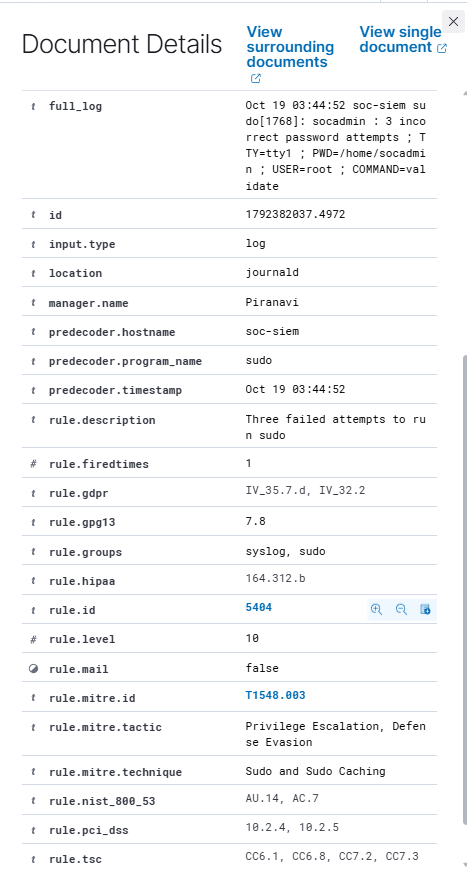

# Linux Privilege Escalation Monitoring — Evidence

## Investigation INC-007: Failed Sudo Authentication

This folder contains evidence collected during a controlled Linux privilege-related authentication monitoring experiment using Wazuh SIEM.

### Detection Details

| Field | Value |
|---|---|
| Monitored Agent | ubuntu-soc-agent |
| Wazuh Rule | 5404 |
| Alert Severity | Level 10 |
| Detection | Three failed attempts to run sudo |
| Source Account | socadmin |
| Target Account | root |
| MITRE ATT&CK | T1548.003 — Sudo and Sudo Caching |
| Log Source | journald |

### Evidence Screenshot

### Findings

Wazuh successfully detected three failed `sudo` password attempts and generated a Level 10 alert.

The experiment was performed using an authorized lab account. No successful privilege escalation was demonstrated.
