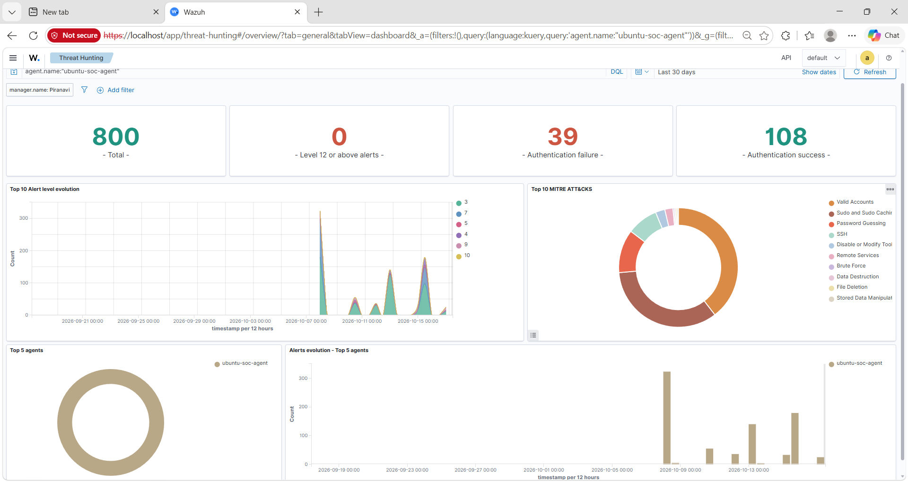

# SOC Monitoring Dashboard Evidence

This folder contains screenshots demonstrating security
monitoring and alert analysis using Wazuh SIEM.

## Monitoring Overview

- Monitored Agent: ubuntu-soc-agent
- Monitoring Period: Last 30 days
- Total Alerts: 800
- High-Severity Alerts (Level 10+): 3
- Custom Detection Rules: 100002 and 100003

## Dashboard Screenshot

## Key Observations

- Security alerts are collected and visualized over time.
- Alert severity levels can be monitored.
- MITRE ATT&CK techniques are mapped to detected events.
- Historical SSH brute-force and root authentication alerts
  are available for investigation.

All attack simulations were performed in an authorized lab.
